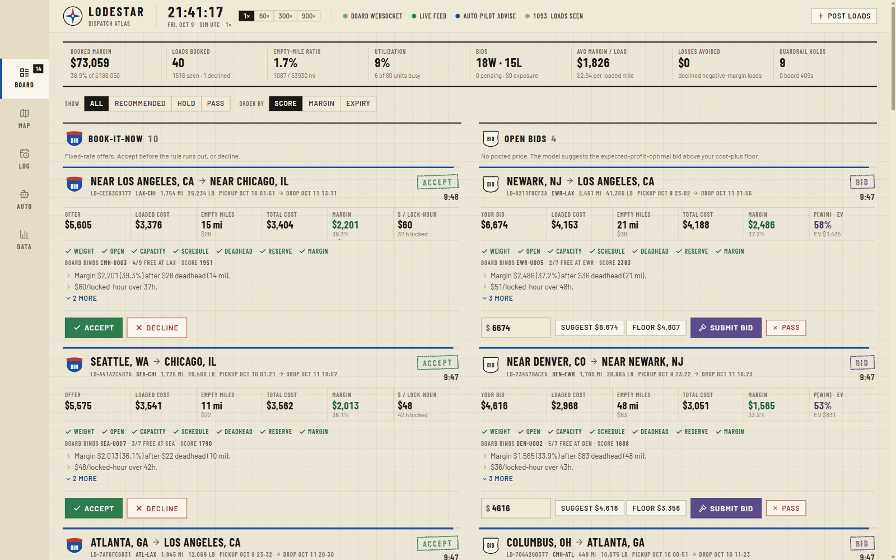
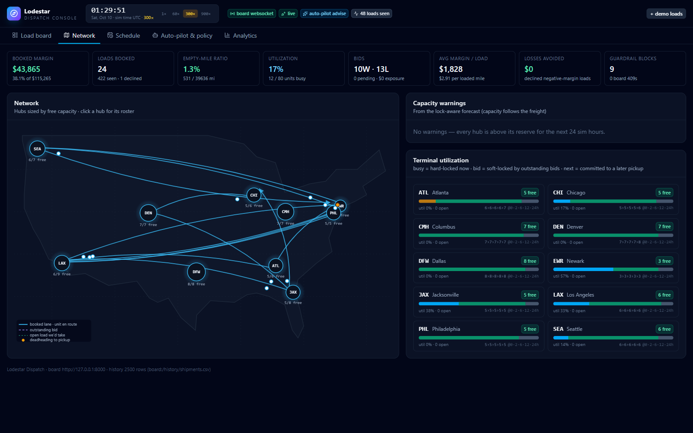
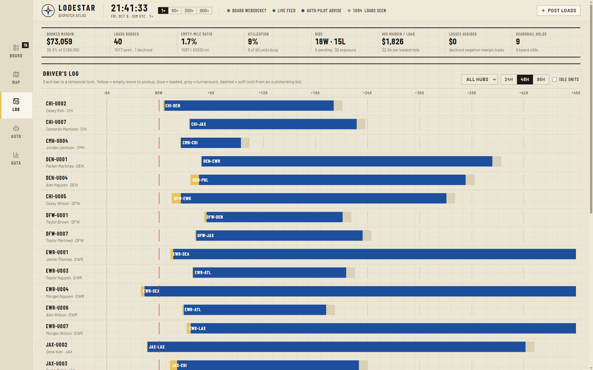
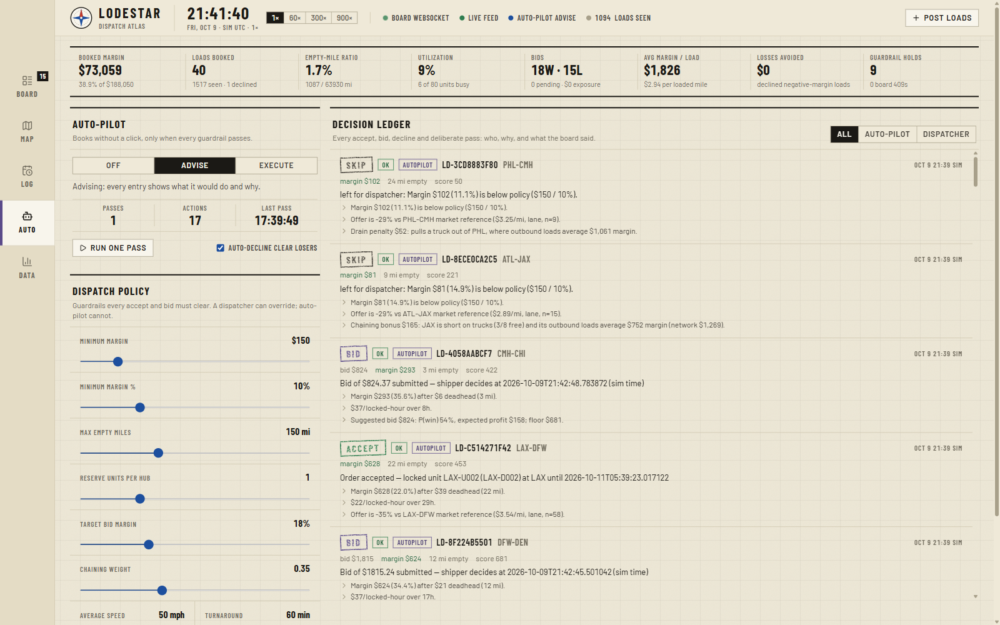
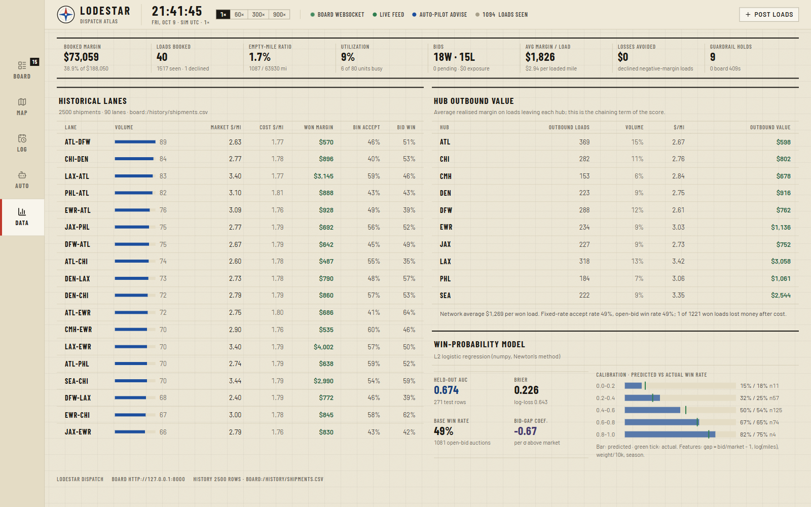

# Lodestar Dispatch

**An intelligent load board and autonomous dispatch engine** for the SFI International
Engineering Mini-Challenge.

**Live demo:** https://lodestar-production-4820.up.railway.app
(board and Lodestar run together in one container; the board posts a new load every 20 s). Lodestar ingests the simulated customer load board in real time,
owns the carrier's fleet schedule as temporal locks, prices open bids from history, enforces
margin and deadhead guardrails on every booking, and can run the desk on auto-pilot — with
every decision explained.



| Doc | What's in it |
|---|---|
| [docs/ARCHITECTURE.md](docs/ARCHITECTURE.md) | System diagram, ERD, data flow, how time-window locking and scoring work |
| [docs/REPORT.md](docs/REPORT.md) | Engineering & business report: constraints, scheduling, empty miles, use of history, volume vs profit, enterprise scaling |
| [docs/DEMO.md](docs/DEMO.md) | Six-minute demo runbook |

## What it does

* **Real-time ingestion** — board WebSocket for new loads plus reconciliation polling; survives socket loss, board restarts and re-seeds.
* **Temporal resource locks** — a unit is committed to `[pickup − deadhead travel, delivery + turnaround)`; feasibility checks use the unit's *projected* position after its previous drop, so chaining ATL→CHI then CHI-outbound works and double-booking cannot.
* **Honest economics on every card** — offer (or suggested bid), loaded cost, empty miles *from the unit the board will actually bind*, total cost, margin in $ / % / per locked hour, and the offer vs the lane's historical market rate.
* **Guardrails** — weight · open · capacity · schedule · deadhead · reserve · margin. Bad bookings are refused *before* the board is called; dispatchers can override the business rails with a note, auto-pilot never can.
* **Chaining-aware score** — `margin + chain_value − drain_penalty` rewards delivering trucks into hubs that are short and pay well outbound, and penalises draining a thin hub.
* **Open-bid pricing** — a numpy logistic win-probability model trained on the 2,500-row history (held-out AUC 0.67) suggests the expected-profit-optimal bid above a cost-plus floor; the UI shows P(win) and EV live as you edit the bid.
* **Auto-pilot** — `off / advise / execute`; books best-score-first through the same guardrails, declines clear losers, leaves borderline loads to humans, and logs every action *and* non-action with reasons.
* **Dispatcher console** — live BIN / open-bid queues with countdowns, one-click accept/decline with the board's own confirmation, bid entry, network map with moving units, per-unit Gantt schedule, lock-aware capacity forecast and warnings, policy sliders, decision ledger, KPIs and history analytics.

## Quick start

Requires Python 3.11+ and Node 20+. The provided board lives in `board/` as a git submodule.

```bash
git clone --recurse-submodules https://github.com/subodh-thallada/lodestar-dispatch.git
cd lodestar-dispatch
python -m venv .venv
.venv\Scripts\activate                      # macOS / Linux: source .venv/bin/activate
pip install -r board/requirements.txt -r backend/requirements.txt
cd frontend && npm install && npm run build && cd ..
```

Run the board and Lodestar in two terminals:

```bash
# terminal 1 — provided load board on :8000 (new load every 10 s for a lively demo; default is 60)
powershell -ExecutionPolicy Bypass -File scripts/run_board.ps1 -IntervalSeconds 10   # or scripts/run_board.sh 8000 10

# terminal 2 — Lodestar on :8100, serving the built console
powershell -ExecutionPolicy Bypass -File scripts/run_lodestar.ps1                    # or scripts/run_lodestar.sh
```

Open **http://127.0.0.1:8100**. API docs are at `/docs`. For frontend development run
`npm run dev` in `frontend/` and open :5173 (it proxies `/api` to :8100).

> If you already cloned without `--recurse-submodules`: `git submodule update --init`.
> If `pip` reports SQLAlchemy's compiled extension cannot load on a locked-down Windows
> machine, `pip install --no-binary sqlalchemy sqlalchemy` installs the pure-Python build.

## Verify

```bash
.venv/Scripts/python -m pytest backend/tests -q     # 18 unit tests: locks, evaluator, pricing, sync
.venv/Scripts/python scripts/e2e_check.py           # 23 checks against both running servers
.venv/Scripts/python scripts/backtest.py            # policy replay over the historical dataset
```

## A tour

<table>
<tr>
<td width="50%"><br/><sub><b>Network</b> — hubs sized by free units, booked lanes with the unit en route, outstanding bids, lock-aware capacity warnings.</sub></td>
<td width="50%"><br/><sub><b>Schedule</b> — the temporal-lock table as a Gantt: amber empty move, blue loaded, grey turnaround, dashed soft locks from bids.</sub></td>
</tr>
<tr>
<td><br/><sub><b>Auto-pilot &amp; policy</b> — mode switch, live-tunable guardrails, and the decision ledger with reasons.</sub></td>
<td><br/><sub><b>Analytics</b> — KPIs, historical lane economics, hub outbound value, pricing-model calibration.</sub></td>
</tr>
</table>

## Deploying

`deploy/Dockerfile` builds one image that runs the provided board (internal :8000) and
Lodestar with the built console (public `$PORT`), so any container host works. The live
demo runs on Railway; CI (`.github/workflows/ci.yml`) runs the backend tests, builds the
console, builds this image and boots it before anything is merged.

```bash
railway init --name lodestar-dispatch
railway add --service lodestar --variables ORDER_INTERVAL_SECONDS=20
railway variables --service lodestar --set RAILWAY_DOCKERFILE_PATH=deploy/Dockerfile
railway up --service lodestar        # uploads the working tree, including the board submodule
railway domain --service lodestar
```

State is SQLite inside the container, so a redeploy resets the sandbox (the board
re-seeds itself and Lodestar re-syncs on boot). WebSockets need no extra configuration.
To check a hosted copy end to end: `python scripts/e2e_check.py --lodestar https://<host> --no-board`.

## Design

The console is drawn as a motor carrier's road atlas: map paper with a coordinate grid,
hairline ink rules instead of boxes, road-hierarchy colour as the only semantic system
(interstate blue for action and loaded miles, highway red for urgent and negative, route
green for accept, urban yellow for caution and empty miles, carbon purple for bids),
Barlow Condensed labels, route shields for load type, and decisions that land as inked
stamps. Tokens and rules are recorded in [DESIGN.md](DESIGN.md); product context in
[PRODUCT.md](PRODUCT.md).

## Repository layout

```
lodestar-dispatch/
├── backend/
│   ├── lodestar/
│   │   ├── main.py             FastAPI app, lifespan (ingest + auto-pilot tasks), serves frontend/dist
│   │   ├── models.py           Lodestar schema (shipments, fleet_units, unit_locks, decisions, …)
│   │   ├── clock.py            mirror of the board's simulation clock
│   │   ├── board/client.py     async client for the provided API
│   │   ├── ingest/             worker (WS + polling + reconciliation) and sync (payload → schema, lock lifecycle)
│   │   ├── engine/             locks · dispatcher (guardrails, score) · pricing · history · execute · autopilot · analytics · policy
│   │   └── api/routes.py       /api/* REST + /api/ws push
│   └── tests/
├── frontend/                   React 19 + Vite + Tailwind dispatcher console
├── board/                      provided Freight Challenge API (git submodule, unmodified)
├── scripts/                    run_*, backtest.py, e2e_check.py
├── deploy/                     Dockerfile + start.sh (board + Lodestar in one image)
└── docs/                       ARCHITECTURE.md, REPORT.md, DEMO.md, screenshots/
```

## Key API endpoints (Lodestar, `:8100`)

| Method | Path | Purpose |
|---|---|---|
| GET | `/api/shipments?status=open\|active\|history\|all` | Loads with cached evaluation (margin, deadhead, guardrails, reasons, suggested bid) |
| GET | `/api/shipments/{id}/evaluate` | Fresh evaluation incl. candidate units ranked by deadhead |
| POST | `/api/shipments/{id}/accept\|decline\|bid` | Guardrails → board → locks → ledger. Body: `{bid_rate?, override?, note?}` |
| GET | `/api/terminals` · `/api/fleet/units` · `/api/schedule` · `/api/capacity/forecast` | Utilization, unit phases/positions, locks, projected free units |
| GET/PUT | `/api/policy` · `/api/autopilot` | Live policy; auto-pilot mode |
| GET | `/api/kpis` · `/api/decisions` · `/api/analytics/history` · `/api/analytics/model` | KPIs, ledger, lane/hub analytics, model metrics |
| POST | `/api/sim/speed` · `/api/sim/spawn` | Demo helpers proxied to the board |
| WS | `/api/ws` | `shipments.changed`, `fleet.changed`, `decision.created`, `clock`, `policy.updated` |

## Configuration

Process settings are environment variables prefixed `LODESTAR_` (see `backend/lodestar/config.py`):
`LODESTAR_BOARD_URL`, `LODESTAR_DATABASE_URL`, `LODESTAR_POLL_INTERVAL_SECONDS`, and the
policy defaults. Policy itself is edited live from the console (or `PUT /api/policy`).
