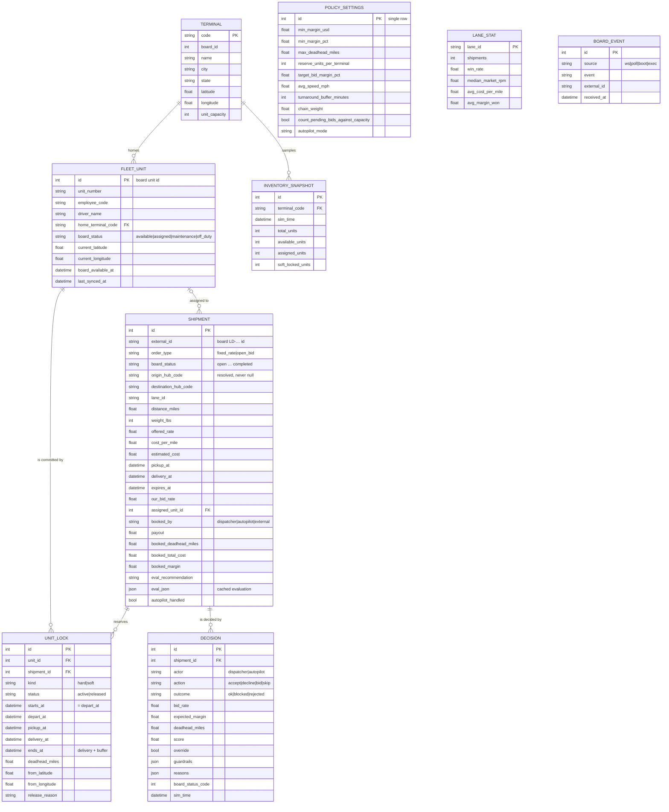

# Lodestar — Architecture

Lodestar is the dispatch brain that sits between a customer load board and a carrier's
fleet. The provided Freight Challenge API plays the board: it publishes loads, takes
accept / decline / bid calls, and simulates the brokerage clock. Everything that decides
*whether* and *how* to book lives in Lodestar.

```
                 ┌─────────────────────────────── Lodestar (FastAPI, :8100) ───────────────────────────────┐
                 │                                                                                          │
 ┌───────────┐   │  ┌──────────────┐    ┌──────────────┐    ┌──────────────────┐    ┌────────────────────┐  │   ┌────────────────────┐
 │ Load board│◀──┼─▶│ Ingestion    │───▶│ Sync layer   │───▶│ Lodestar DB      │◀──▶│ REST + WebSocket   │◀─┼──▶│ Dispatcher console │
 │ (:8000)   │ WS│  │ WS + polling │    │ upsert /     │    │ SQLite (WAL)     │    │ /api/*             │  │   │ React + Vite       │
 │ orders,   │+  │  │ reconcile    │    │ transitions  │    │ shipments, locks,│    │ /api/ws push       │  │   │ board · network ·  │
 │ fleet,    │REST  └──────────────┘    └──────┬───────┘    │ decisions, …     │    └────────────────────┘  │   │ schedule · policy  │
 │ history,  │   │                             │            └────────┬─────────┘                            │   └────────────────────┘
 │ clock     │◀──┼───────────────┐             ▼                     │                                      │
 └───────────┘   │               │   ┌──────────────────┐   ┌────────▼─────────┐   ┌────────────────────┐   │
   accept/bid    │               └───│ Booking executor │◀──│ Dispatch engine  │◀──│ History analytics  │   │
   decline       │                   │ guardrails →     │   │ locks · deadhead │   │ lane market rates, │   │
                 │                   │ board → ledger   │   │ margin · chain   │   │ hub value, pricing │   │
                 │                   └────────▲─────────┘   │ score · recommend│   │ model (numpy LR)   │   │
                 │                            │             └──────────────────┘   └────────────────────┘   │
                 │                   ┌────────┴─────────┐                                                   │
                 │                   │ Auto-pilot worker│  off · advise · execute                            │
                 │                   └──────────────────┘                                                   │
                 └──────────────────────────────────────────────────────────────────────────────────────────┘
```

## Components

| Component | Module | Responsibility |
|---|---|---|
| Board client | `backend/lodestar/board/client.py` | Thin async HTTP client for the provided API; raises typed `BoardError(status, detail)` |
| Sim clock mirror | `backend/lodestar/clock.py` | Local projection of the board's accelerated clock (`sim = sim_at_sync + Δwall × speed`), re-synced every poll |
| Ingestion worker | `backend/lodestar/ingest/worker.py` | Board WebSocket for instant `order.created`; polling every 3 s for reconciliation (expiry, bid awards, deliveries, restarts); fleet snapshot every 4 s |
| Sync layer | `backend/lodestar/ingest/sync.py` | Board payload → Lodestar schema; status transitions drive lock lifecycle and booking economics |
| Temporal locks | `backend/lodestar/engine/locks.py` | Per-unit intervals `[depart, delivery + buffer)`, projected position, conflict checks |
| Dispatch engine | `backend/lodestar/engine/dispatcher.py` | Guardrails, deadhead from the unit the board will bind, margin, chaining score, recommendation |
| Pricing model | `backend/lodestar/engine/pricing.py` | Win-probability logistic regression + expected-profit bid search |
| History analytics | `backend/lodestar/engine/history.py` | Lane market rates, hub outbound value, distance-band fallbacks |
| Booking executor | `backend/lodestar/engine/execute.py` | guardrails → board call → mirror result → locks → decision ledger → push |
| Auto-pilot | `backend/lodestar/engine/autopilot.py` | Scores the open board every 2 s, books best-first, leaves borderline calls to humans |
| API | `backend/lodestar/api/routes.py` | `/api/shipments`, `/fleet`, `/terminals`, `/schedule`, `/capacity/forecast`, `/kpis`, `/decisions`, `/policy`, `/autopilot`, `/analytics/*`, `/sim/*`, `/ws` |
| Console | `frontend/src` | React 19 + Vite + Tailwind; one WebSocket + polling fallback feeds every panel |

## Entity-relationship diagram



Three design decisions worth calling out:

* **`fleet_units.id` is the board's unit id.** The board physically binds a unit when a
  booking succeeds and moves its capacity when the delivery completes. Diverging from
  that binding would make our inventory drift from the sandbox within a few deliveries,
  so Lodestar *predicts* which unit the board will bind (same nearest-free rule), plans
  its lock against that unit, and confirms from the booking response.
* **Locks are intervals, not flags.** A unit is not "busy" or "free"; it is committed to
  specific windows. That is what makes pre-booking a unit for a load that picks up after
  its current delivery possible, and what makes double-booking impossible.
* **Evaluations are cached on the shipment.** Every ingest tick re-evaluates open loads
  and stores the result (`eval_json`), so the UI's list endpoint is a plain read and every
  card can show margin, deadhead and the reasons without a round trip.

## Data flow

### 1. Boot

1. Wait for `GET /health` on the board (retry with back-off; the API still serves a
   `503 bootstrapping` answer meanwhile).
2. Sync the clock, upsert terminals and the fleet snapshot.
3. Pull `/history/shipments.csv` (fallback: the CSV in `board/data/`), build the
   `LaneIndex` and train the pricing model (~50 ms for 2,500 rows).
4. Pull `/orders?status=all`, upsert, evaluate every open load.

### 2. Live loop

```
board WS  ──order.created──▶ upsert ─▶ evaluate ─▶ cache ─▶ push "shipments.changed"
          ──lifecycle─────▶ request immediate poll
poll (3s) ──/orders?status=all──▶ upsert each ─▶ transition? ─▶ locks ─▶ evaluate open ─▶ push
          ──/simulation/clock──▶ re-sync sim clock
          ──/fleet/snapshot (4s)──▶ unit status/position/home ─▶ inventory sample ─▶ push "fleet.changed"
          ──reconcile: live loads the board no longer lists ─▶ GET each ─▶ 404 ⇒ "gone" (restart handling)
```

Expiry countdowns are not polled: the UI ticks its own copy of the sim clock and
compares to `expires_at`; the backend expires locally when the clock passes it even if
the board has not told us yet.

### 3. Booking (dispatcher click or auto-pilot)

```
POST /api/shipments/{id}/accept|bid|decline
  ├─ evaluate()                  guardrails: weight · open · capacity · schedule · deadhead · reserve · margin
  ├─ blocked?  → Decision(outcome=blocked) → 422 with the failing rails (dispatcher may override the overridable ones)
  ├─ board call                  409/400 → Decision(outcome=rejected), re-read the order, 4xx to UI with the board's detail
  └─ ok → upsert board response → apply_transition():
              accept  → hard lock on the bound unit, booking economics (payout, deadhead, total cost, margin)
              bid     → soft lock on the predicted unit (exposure), resolved on award/loss
          → Decision(outcome=ok) → push shipment.updated / fleet.changed / decision.created
```

### 4. Lifecycle transitions (from the board, via sync)

| Board transition | Lodestar action |
|---|---|
| `bid_submitted → accepted` (bid won) | release soft lock, create hard lock on the bound unit, fill payout = winning bid |
| `accepted → in_transit` | nothing (lock already covers it); UI interpolates unit position |
| `→ completed` | release lock, unit home hub := destination hub, position := drop (mirrors the board) |
| `→ bid_lost / expired / declined` | release any lock |
| live load vanishes from the board (404) | status `gone`, locks released, counted as a restart if several vanish together |

## Time-window locking, in detail

A lock for shipment *S* on unit *U* covers

```
depart_at = S.pickup_at − deadhead_miles / avg_speed_mph
ends_at   = S.delivery_at + turnaround_buffer
lock      = [depart_at, ends_at)
```

`deadhead_miles` is measured from the unit's **projected position** at `pickup_at`:
if *U* has an earlier lock that ends before `depart_at`, the position is that load's
destination, not where the board says the truck is right now. A plan is feasible only if

1. *U* is not maintenance / off-duty,
2. no active lock covers `pickup_at`,
3. *U* is free (end of its last prior lock, or the board's `available_at`) **before**
   `depart_at`, i.e. it can physically reach the pickup on time, and
4. the interval `[depart_at, ends_at)` overlaps no other active lock.

Soft locks (outstanding bids) are included in these checks when the policy says bids
count against capacity; otherwise only hard locks do. Capacity per hub at any instant is
"usable units homed here that the board considers free and that have no lock covering
that instant", and the forecast walks every unit's locks to project where it will be at
+2 / +6 / +12 / +24 h, so capacity that is *inbound* on a delivery shows up at the
destination hub before the board has moved it.

## Scoring

```
total_cost     = estimated_cost + deadhead_miles × cost_per_mile       (deadhead from the bound unit's projected position)
margin         = payout − total_cost                                   (payout = offered_rate, or the suggested bid)
chain_value    = chain_weight × outbound_value[dest] × scarcity[dest]  (scarcity = 1 − projected_free/usable at delivery time)
drain_penalty  = chain_weight × outbound_value[origin] × scarcity_after[origin] × (1.0 if the hub ends at/below reserve+1 else 0.35)
score          = margin + chain_value − drain_penalty
```

`outbound_value[hub]` is the average realised margin on historical loads leaving that
hub. The score ranks loads for auto-pilot; the recommendation shown to dispatchers is
categorical: **accept / bid** when every rail passes, **decline / pass** when the
economics fail, **hold** when only capacity or schedule fails (a truck may free up
before expiry).

## Open-bid pricing

Features known for a live order: `gap = bid_rpm / lane_market_rpm − 1`, `log(miles)`,
`weight/10k`, season. L2 logistic regression (Newton's method, numpy) on the 1,081
historical auctions; 75/25 split for reporting (AUC ≈ 0.67, Brier ≈ 0.23) then refit
on everything. The suggested bid maximises `P(win | bid) × (bid − total_cost)` over a
61-point grid, floored at `max(total_cost + min_margin_usd, total_cost × (1 + min_margin_pct))`.

## Failure modes handled

* Board down at boot → API serves, UI shows "board offline", worker retries with back-off.
* Board WebSocket blocked → polling alone drives everything; mode badge shows `polling`.
* Board restarted / re-seeded → live loads 404 → marked `gone`, locks released, counter incremented.
* Board 409 on a booking we thought was fine (race with expiry) → decision recorded as
  `rejected 409`, order re-read, card disappears or updates; no local lock is left behind.
* Board binds a unit our model considers infeasible → lock is still created (board is
  truth) and a `lock.forced` event is recorded so the discrepancy is visible.

## Scaling notes

The current build is a single process with SQLite in WAL mode, which comfortably handles
the challenge board (tens of loads per minute, 80 units). The seams for growing it are
already in the code: the ingestion worker, auto-pilot and API share nothing but the
database and the push hub, so they split into separate services behind Postgres with
`SELECT … FOR UPDATE` on `unit_locks` for multi-dispatcher safety; the push hub becomes
a Redis pub/sub channel; the evaluator is pure and parallelises per hub. See the report
for the enterprise roadmap.
